## About the Project 

    
      A tool which parses information from a resume using natural language processing and finds the keywords, cluster them onto sectors based on their keywords. 
      And lastly show recommendations, predictions, analytics to the applicant / recruiter based on keyword matching.

## Scope 😲
i. It can be used for getting all the resume data into a structured tabular format and csv as well, so that the organization can use those data for analytics purposes

ii. By providing recommendations, predictions and overall score user can improve their resume and can keep on testing it on our tool

iii. And it can increase more traffic to our tool because of user section

iv. It can be used by colleges to get insight of students and their resume before placements

v. Also, to get analytics for roles which users are mostly looking for

vi. To improve this tool by getting feedbacks


- 📄 AI-powered resume analysis and feedback
- 🛠️ Resume creation and customization with Resume Studio
- 🔥 Resume Roast for resume feedback
- 🎯 Interview practice and job preparation

</sub>

<!-- TechStack -->
## Tech Stack 🍻
<details>
  <summary>Frontend</summary>
  <ul>
    <li><a href="https://streamlit.io/">Streamlit</a></li>
    <li><a href="https://developer.mozilla.org/en-US/docs/Learn/HTML">HTML</a></li>
    <li><a href="https://developer.mozilla.org/en-US/docs/Web/CSS">CSS</a></li>
    <li><a href="https://developer.mozilla.org/en-US/docs/Learn/JavaScript">JavaScript</a></li>
  </ul>
</details>

<details>
  <summary>Backend</summary>
  <ul>
    <li><a href="https://streamlit.io/">Streamlit</a></li>
    <li><a href="https://www.python.org/">Python</a></li>
  </ul>
</details>

<details>
<summary>Database</summary>
  <ul>
    <li><a href="https://www.mysql.com/">MySQL</a></li>
  </ul>
</details>

<details>
<summary>Modules</summary>
  <ul>
    <li><a href="https://pandas.pydata.org/">pandas</a></li>
    <li><a href="https://github.com/OmkarPathak/pyresparser">pyresparser</a></li>
    <li><a href="https://pypi.org/project/pdfminer3/">pdfminer3</a></li>
    <li><a href="https://plotly.com/">Plotly</a></li>
    <li><a href="https://www.nltk.org/">NLTK</a></li>
  </ul>
</details>

<!-- Features -->
## Features 🤦‍♂️
### Client: -
- Fetching Location and Miscellaneous Data

  Using Parsing Techniques to fetch
- Basic Info
- Skills
- Keywords

Using logical programs, it will recommend
- Skills that can be added
- Predicted job role
- Course and certificates
- Resume tips and ideas
- Overall Score
- Interview & Resume tip videos

### Admin: -
- Get all applicant’s data into tabular format
- Download user’s data into csv file
- View all saved uploaded pdf in Uploaded Resume folder
- Get user feedback and ratings
  
  Pie Charts for: -
- Ratings
- Predicted field / roles
- Experience level
- Resume score
- User count
- City
- State
- Country

### Feedback: -
- Form filling
- Rating from 1 – 5
- Show overall ratings pie chart
- Past user comments history 

## Requirements 😅
### Have these things installed to make your process smooth 
1) Python (3.9.12) https://www.python.org/downloads/release/python-3912/
2) MySQL https://www.mysql.com/downloads/
3) Visual Studio Code **(Prefered Code Editor)** https://code.visualstudio.com/Download
4) Visual Studio build tools for C++ https://aka.ms/vs/17/release/vs_BuildTools.exe

## Setup & Installation 👀

From the repository root, create a virtual environment and install the dependencies:

```powershell
py -3.9 -m venv .venv
.\.venv\Scripts\Activate.ps1
python -m pip install --upgrade pip
pip install -r requirements.txt
streamlit run streamlit_app.py
```

Open the local URL printed by Streamlit (usually `http://localhost:8501`). The app uses SQLite by default. To use MySQL, configure `MYSQL_HOST`, `MYSQL_USER`, and `MYSQL_PASSWORD`; `MYSQL_DATABASE` is optional and defaults to `cv`. Keep database credentials out of source files.

## Deploy on Streamlit Community Cloud

1. Push this repository to GitHub. Do not commit `.env` files, `.streamlit/secrets.toml`, local databases, virtual environments, or uploaded resumes.
2. In [Streamlit Community Cloud](https://share.streamlit.io/), create an app from the repository and select `streamlit_app.py` as the main file.
3. In the app's **Settings → Secrets**, set unique values for `ADMIN_USERNAME` and `ADMIN_PASSWORD`. For MySQL-backed storage, also set `MYSQL_HOST`, `MYSQL_USER`, `MYSQL_PASSWORD`, and optionally `MYSQL_DATABASE` (defaults to `cv`).
4. Deploy the app. If MySQL settings are omitted, the app uses SQLite; hosted SQLite storage may not persist across redeployments.

Uploaded PDFs are retained in `App/Uploaded_Resumes`; extracted resume and contact/usage details are stored in the database. Files are not automatically deleted, so do not use this demo for confidential resumes without adding a suitable retention and deletion process. The app displays this notice to visitors.

The Admin page is unavailable until you configure the admin secrets. Never reuse credentials from another account.

## Known Error 🤪
If ``GeocoderUnavailable`` error comes up then just check your internet connection and network speed

## Issue While Installation and Set-up 🤧
Check-out installation and open an issue if you encounter any problem.

## Usage
- After the setup it will do stuff's automatically
- You just need to upload a resume and see it's magic
- Try uploading a resume in PDF format
- Configure `ADMIN_USERNAME` and `ADMIN_PASSWORD` in app secrets before using the Admin page.

<!-- Roadmap -->
## Roadmap 🛵
* [x] Predict user experience level.
* [x] Add resume scoring criteria for skills and projects.
* [x] Added fields and recommendations for web, android, ios, data science.
* [ ] Add more fields for other roles, and its recommendations respectively. 
* [x] Fetch more details from users resume.
* [ ] View individual user details.

## Contributing 🤘
Pull requests are welcome. 

For major changes, please open an issue first to discuss what you would like to change.

I've attached the <a href="./RESUME%20ANALYSER%20SYNOPSIS.pdf">synopsis</a> of the project

## Acknowledgement 🤗
- <a href="https://www.linkedin.com/in/mrbriit/">Dr Bright</a> - <a href="https://www.udemy.com/course/the-full-stack-data-scientist-bootcamp/">(The Full Stack Data Scientist BootCamp)</a>
- <a href="https://www.academia.edu/32543544/Resume_Parser_with_Natural_Language_Processing">Resume Parser with Natural Language Processing</a>
- <a href="https://github.com/OmkarPathak/pyresparser">pyresparser</a>

## Preview 👽

### Client Side

**Main Screen**

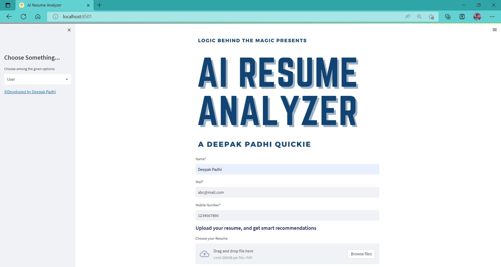

**Resume Analysis**

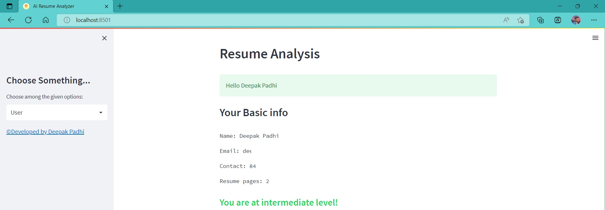

**Skill Recommendation**

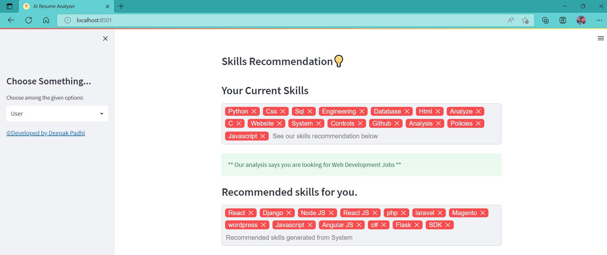

**Course Recommendation**

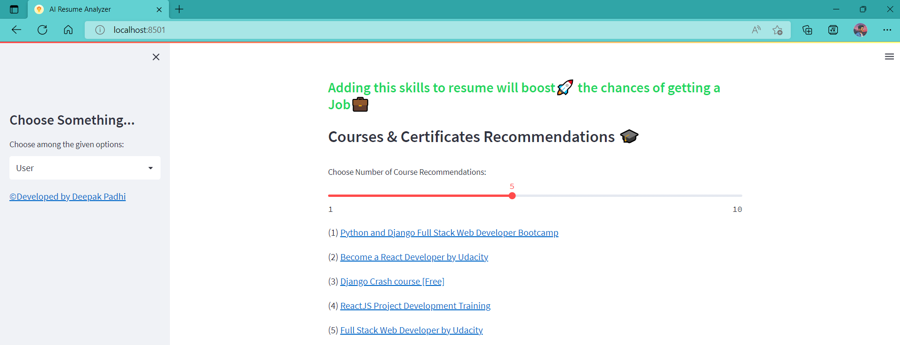

**Tips and Overall Score**

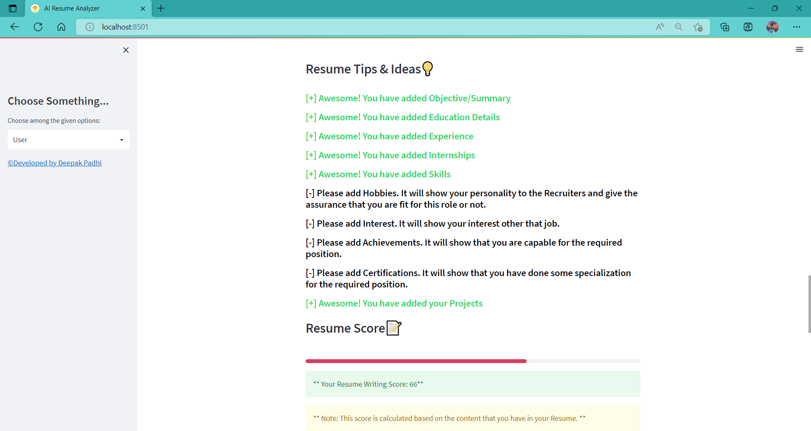

**Video Recommendation**

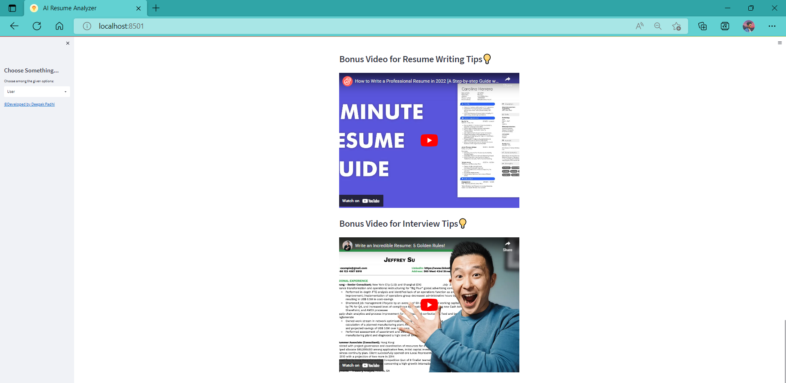

### Feedback

**Feedback Form**

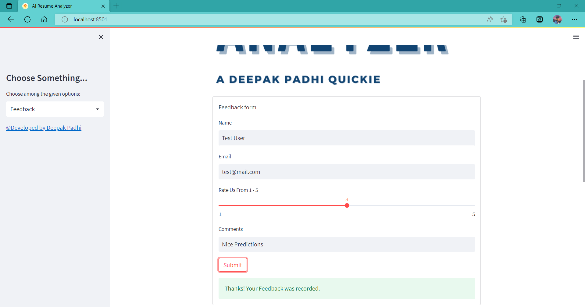

**Overall Rating Analysis and Comment History**

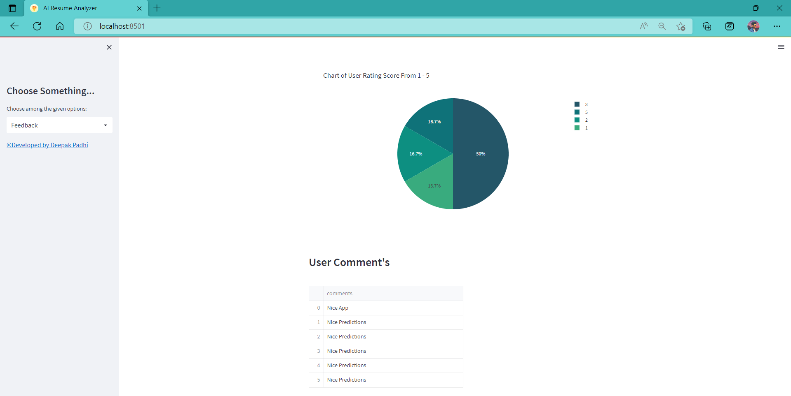

### Admin

**Login**

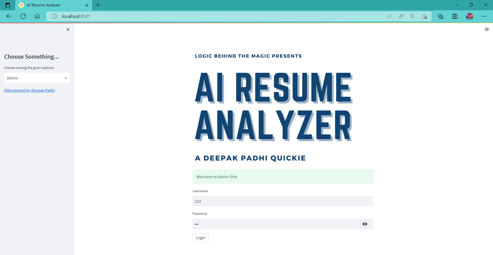

**User Count and it's data**

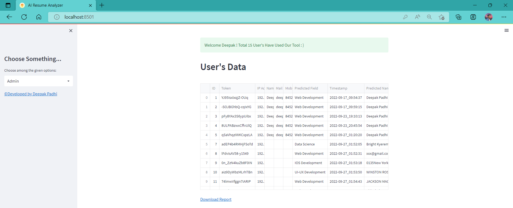

**Exported csv file**

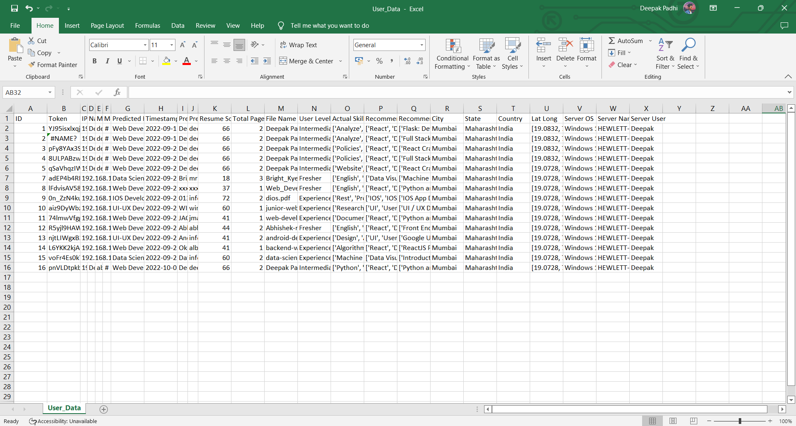

**Feedback Data**

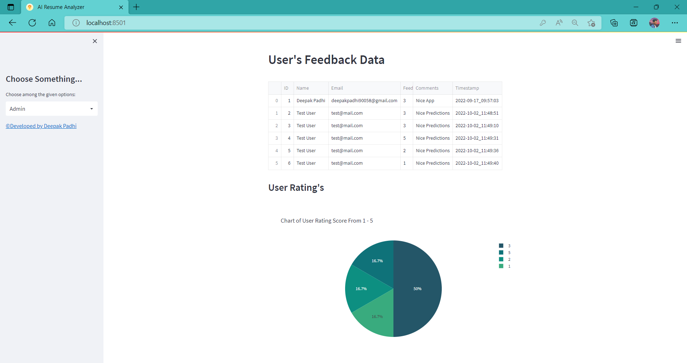

**Pie Chart Analytical Representation of clusters**

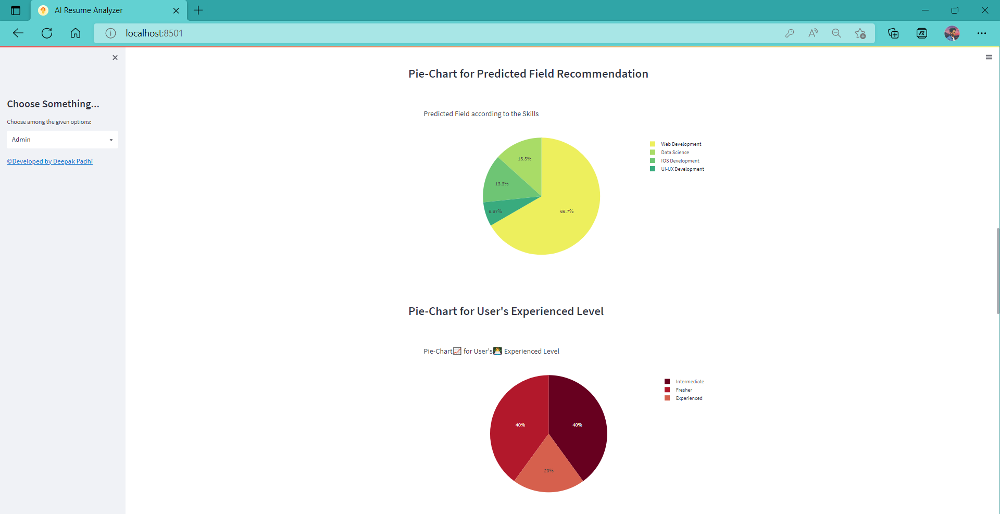

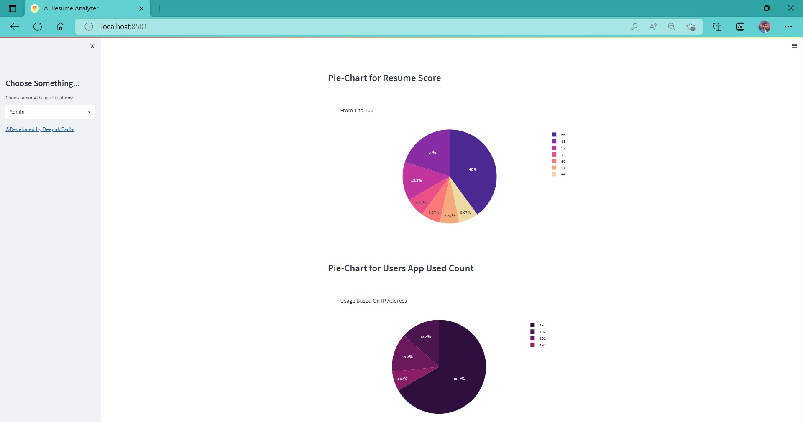

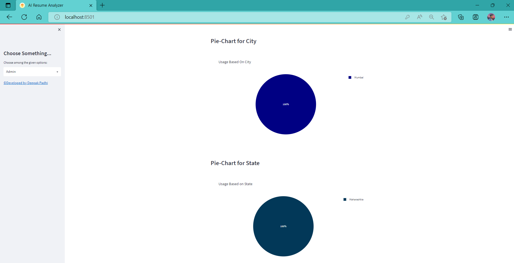

### Built with 🤍 AI RESUME ANALYZER
